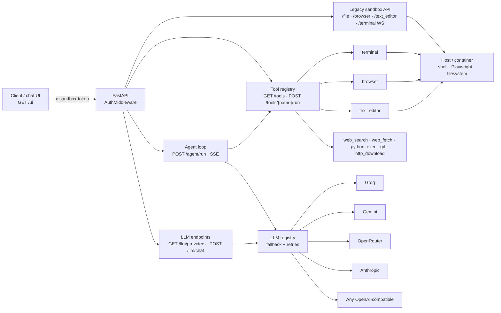

# Sandbar

**بيئة معزولة (sandbox) للوكلاء تُستضاف ذاتيًا: واجهات طرفية ومتصفح وملفات عبر HTTP/WS، وسجل أدوات، وطبقة نماذج لغوية متعددة المزوّدين، وحلقة وكيل تبثّ نتائجها مباشرة، مع واجهة محادثة مدمجة.**

[](https://github.com/kasdo-iq/sandbar/actions/workflows/ci.yml)
[-blue.svg)](LICENSE)


> النسخة الإنجليزية: [README.md](README.md)

---

## ما هذا المشروع

يشغّل Sandbar خدمة FastAPI صغيرة تمنح وكيلًا يعمل بنموذج لغوي تحكّمًا منضبطًا في
جهاز حقيقي: طرفية دائمة، ومتصفح Playwright، ومحرّر ملفات/نصوص، ومجموعة أدوات
شبكية وأدوات لإدارة العمليات. كل مسار محمي برمز (token)، والعملية نفسها تستضيف
حلقة الوكيل وواجهة المحادثة — افتح
`http://127.0.0.1:8330/ui` في المتصفح وابدأ العمل، دون واجهة أمامية منفصلة
تحتاج بناءً أو نشرًا.

المشروع تحديث لـ [whit3rabbit/manus-open](https://github.com/whit3rabbit/manus-open)،
وهو إعادة بناء لبيئة Manus المعزولة. أُبقيت الواجهة القديمة المتوافقة مع Manus كما
هي على مستوى الـ API، وأُضيف هنا: طبقة المصادقة، وطبقة النماذج، وسجل الأدوات،
وحلقة الوكيل، وواجهة المحادثة، والاختبارات، والتكامل المستمر.

### الفرق عن المشروع الأصلي

| | الأصل `whit3rabbit/manus-open` | Sandbar |
|---|---|---|
| المصادقة | لا توجد | رمز على كل مسار HTTP وعلى مصافحة WebSocket، وإقلاع مغلق عند غياب الرمز، وحد للمحاولات الفاشلة (`429`) |
| النماذج | Claude فقط عبر الوكيل المضمّن | سجل مزوّدين: Groq وGemini وOpenRouter وAnthropic وأي خدمة متوافقة مع OpenAI، مع سلسلة احتياطية |
| الأدوات | مسارات ثابتة | سجل بمخططات JSON، و`GET /tools`، و`POST /tools/{name}/run`، وأدوات إضافية عبر `custom_tools/` |
| الوكيل | — | `POST /agent/run`، حلقة استدعاء أدوات تبثّ SSE مع حدود للخطوات والوقت |
| الواجهة | — | `GET /ui`، صفحة ثابتة واحدة |
| التحصين | CORS بقيمة `*`، بلا فحص للمسارات | قائمة CORS مسموحة، وفحص جذور الملفات المسموحة، وحماية SSRF، وتأمين أوامر المحرّر بـ `shlex` |
| الجودة | بلا اختبارات | 57 اختبارًا تعمل دون إنترنت، وruff، وتكامل مستمر عبر GitHub Actions |

## المزايا

**واجهات بيئة معزولة (متوافقة مع Manus)**

- طرفيات دائمة عبر WebSocket ببروتوكول `[CMD_BEGIN]…[CMD_END]`، مع مسارات
  `reset / reset-all / view / write / kill` لكل جلسة.
- تحكّم بمتصفح Playwright: Chromium المضمّن (بلا واجهة افتراضيًا) أو الربط
  بمتصفح Brave/Chrome الخاص بك عبر CDP.
- رفع وتنزيل الملفات بما في ذلك الرفع متعدد الأجزاء إلى S3، وإجراءات محرّر
  النصوص، وتهيئة البيئة، وضغط المشروع ورفعه.

**الأمان**

- مصادقة برمز على كل مسار HTTP وعلى مصافحة WebSocket (رمز الإغلاق `1008` قبل
  القبول).
- إقلاع مغلق عند غياب الرمز، ومقارنة بزمن ثابت، وتحديد معدّل المحاولات
  الفاشلة (`429` مع `Retry-After`).
- قائمة CORS مسموحة، وفحص الجذور المسموحة (رفض الخروج من المسار والتلاعب
  بالروابط الرمزية)، وحماية SSRF في الطلبات الصادرة، وتأمين أوامر المحرّر
  بـ `shlex`.

**طبقة النماذج**

- `providers.yaml` مع تجاوزات من متغيّرات البيئة: Groq وGemini وOpenRouter
  وAnthropic وأي خدمة متوافقة مع OpenAI.
- سلسلة احتياطية مع إعادة المحاولة وتباعد أسّي، وتجاوز المزوّد/الطراز لكل
  طلب، و`GET /llm/providers` لا يعيد المفاتيح أبدًا.
- `POST /llm/chat` لطلب واحد أو بثّ SSE، ومحوّل LangChain كي يعمل الوكيل
  المضمّن مع أي مزوّد مُهيّأ.

**الأدوات والوكيل**

- سجل بمخططات JSON: `GET /tools` و`POST /tools/{name}/run`.
- أدوات مدمجة: `terminal` و`browser` و`text_editor` و`python_exec` و`web_fetch`
  و`web_search` و`file_search` و`git` و`http_download` و`process_manager`.
- `POST /agent/run`: حلقة استدعاء أدوات تبثّ SSE مع `max_steps` ومهلة كلية،
  واقتطاع مخرجات الأدوات قبل إعادتها إلى النموذج.
- أضف ملف `.py` في `custom_tools/` لتسجيل أداة خاصة عند بدء التشغيل.

**واجهة المحادثة**

- `/ui`: صفحة ثابتة واحدة، بلا خطوة بناء، بلا CDN، تعمل دون إنترنت.
- تبثّ استجابات الوكيل عبر SSE، وتعرض Markdown بعد تهريبه، وتُظهر كل استدعاء
  أداة كعنصر قابل للطي، مع اختيار المزوّد وزر إيقاف وإدخال صوتي اختياري،
  وسمة داكنة، وفقاعات رسائل بـ `dir="auto"` تناسب العربية والإنجليزية.

## المعمارية



يذهب الطلب إمّا مباشرة إلى واجهة قديمة، أو عبر سجل الأدوات. تتناوب
`POST /agent/run` بين سجل النماذج وسجل الأدوات حتى يجيب النموذج أو تنفد ميزانية
الخطوات/الوقت، مع بثّ أحداث SSE طوال ذلك. واجهة المحادثة ليست إلا عميلًا آخر
للـ API نفسه.

## المتطلبات

- **Python 3.11 أو أحدث** (الحاوية تستهدف 3.11، ويعمل أيضًا 3.12).
- **Linux أو WSL أو Docker** لأداتي الطرفية ومحرّر النصوص: تحتاجان `pexpect`
  وصدفة POSIX. خادم HTTP يعمل على Windows وmacOS، لكن هاتين الأداتين تفشلان
  هناك. أما المصادقة وطبقة النماذج وأدوات HTTP وواجهة المحادثة فتعمل على كل
  الأنظمة.
- **Chromium الخاص بـ Playwright** إن استخدمت المتصفح المضمّن:
  `python -m playwright install chromium`. تخطَّه إن ربطت متصفحك عبر CDP.
- مفتاح نموذج واحد على الأقل لميزات الوكيل/النماذج. مفاتيح البحث اختيارية.

## البدء السريع

```bash
git clone https://github.com/kasdo-iq/sandbar.git
cd sandbar

python -m venv .venv
source .venv/bin/activate            # Windows: .\.venv\Scripts\Activate.ps1
pip install -r requirements.txt
pip install -r requirements-dev.txt  # tests + ruff

cp .env.example .env
cp providers.example.yaml providers.yaml

# generate a token and put it in SANDBOX_API_TOKEN in .env
python -c "import secrets; print(secrets.token_hex(32))"

python -m playwright install chromium
python start_server.py --port 8330
```

للتحقق:

```bash
curl http://127.0.0.1:8330/healthz
curl http://127.0.0.1:8330/llm/providers                       # 401 without a token
curl -H "x-sandbox-token: $SANDBOX_API_TOKEN" \
     http://127.0.0.1:8330/llm/providers                       # 200
```

ثم افتح <http://127.0.0.1:8330/ui> وألصق الرمز مرة واحدة.

يقبل `start_server.py` الوسائط `--port` (الافتراضي `8330`) و`--host` (الافتراضي
`0.0.0.0`) و`--log-level` و`--chrome-path`. للاستخدام المحلي، `--host 127.0.0.1`
يبقي الخدمة خارج الشبكة.

> **Windows:** شغّل الخادم من البيئة الافتراضية للمشروع
> (`.\.venv\Scripts\python start_server.py`). الطرفية و`text_editor` لن تعملا
> خارج WSL/Docker — راجع المتطلبات.

## الإعدادات

كل القيم يمكن أن توضع في `.env` (يُحمَّل عند الاستيراد) أو في متغيّرات البيئة.
انسخ `.env.example`، ولا تُودِع الناتج أبدًا.

| المتغيّر | الغرض | الافتراضي |
|---|---|---|
| `SANDBOX_API_TOKEN` | رمز كل المسارات | **مطلوب** (أو `AUTH_DISABLED=true`) |
| `AUTH_DISABLED` | التشغيل بلا مصادقة (تحذير صارخ، للتطوير المحلي فقط) | `false` |
| `CORS_ORIGINS` | قائمة CORS مسموحة مفصولة بفواصل | فارغ (لا وصول عبر الأصول) |
| `MANUS_COMPAT` | تفعيل عميل Manus الوكيل في `data_api.py` | `true` |
| `RUNTIME_API_HOST` | مضيف وكيل Manus لـ `data_api.py` | `https://api.manus.im` |
| `PROVIDERS_CONFIG` | مسار ملف إعداد المزوّدين | `providers.yaml` |
| `LLM_DEFAULT_PROVIDER`، `LLM_FALLBACK` | تجاوزات التوجيه | من `providers.yaml` |
| `LLM_<NAME>_MODEL`، `_BASE_URL`، `_ENABLED`، `_API_KEY`، `_TEMPERATURE`، `_MAX_TOKENS`، `_SYSTEM_PROMPT` | تجاوزات لكل مزوّد | من `providers.yaml` |
| `GROQ_API_KEY`، `GEMINI_API_KEY`، `OPENROUTER_API_KEY`، `ANTHROPIC_API_KEY` | مفاتيح المزوّدين، تُشار إليها بالاسم من `providers.yaml` | — |
| `TAVILY_API_KEY`، `SERPER_API_KEY`، `SEARXNG_URL` | خلفيات `web_search` بهذا الترتيب | — |
| `SANDBOX_ALLOWED_ROOTS` | جذور مسموحة لكل مسار يلمس الملفات | مجلد العمل (`/home/ubuntu` في الحاوية) |
| `SANDBOX_ALLOW_SUDO` | يضبطه Dockerfile من وسيط البناء `ALLOW_SUDO` | `true` |
| `CUSTOM_TOOLS_DIR` | مجلد الأدوات الإضافية | `custom_tools` |
| `AGENT_MAX_STEPS` | أقصى عدد خطوات للنموذج في التشغيل | `15` |
| `AGENT_TOTAL_TIMEOUT` | ميزانية الوقت الكلية للتشغيل، بالثواني | `300` |
| `AGENT_SYSTEM_PROMPT` | يستبدل موجّه النظام المدمج | المدمج |
| `AGENT_OUTPUT_MAX_CHARS` | اقتطاع مخرجات الأدوات قبل إعادتها للنموذج | `16000` |
| `PYTHON_EXEC_TIMEOUT`، `PYTHON_EXEC_MAX_MEMORY_MB` | حدود `python_exec` | `60`، `1024` |
| `WEB_FETCH_MAX_BYTES`، `WEB_FETCH_TIMEOUT`، `HTTP_DOWNLOAD_TIMEOUT` | حدود الطلبات الصادرة | `5 MiB`، `30`، `60` |
| `CHROME_INSTANCE_PATH` | مسار ملف Chrome للوكيل المضمّن | غير مضبوط (Chromium المضمّن) |
| `BROWSER_HEADLESS` | `false` يفتح نافذة متصفح مرئية | `true` |
| `BROWSER_CDP_URL` | الربط بمتصفح قائم، مثل `http://localhost:9222` | غير مضبوط |
| `BROWSER_USE_LOGGING_LEVEL` | مستوى سجل الوكيل المضمّن | `info` |
| `ANONYMIZED_TELEMETRY` | قياسات PostHog من الوكيل المضمّن | `false` في `.env.example` |
| `LAMINAR_API_KEY` | يفعّل تتبّع Laminar عند ضبطه فقط | غير مضبوط |

مفاتيح المزوّدين **لا** تُخزَّن في `providers.yaml`؛ الملف يذكر فقط اسم متغيّر
البيئة (`api_key_env`) الذي يحمل المفتاح.

## المصادقة

- أرسل `x-sandbox-token: <token>` (متوافق مع Manus) **أو**
  `Authorization: Bearer <token>`.
- الرمز يأتي من `SANDBOX_API_TOKEN`. المقارنة بزمن ثابت
  (`hmac.compare_digest`) والرموز لا تُسجَّل أبدًا.
- تُطبَّق على كل مسار HTTP **ما عدا** `GET /healthz` و`GET /ui` (الصفحة الثابتة؛
  وكل استدعاء API تقوم به يحتاج الرمز).
- **إقلاع مغلق:** بلا رمز يرفض الخادم العمل ما لم يُضبط `AUTH_DISABLED=true`
  صراحةً.
- WebSocket `/terminal`: الرمز من ترويسات المصافحة أو من `?token=`؛ والرمز غير
  الصحيح يغلق الاتصال بالرمز `1008` قبل القبول.
- أكثر من 10 محاولات فاشلة لكل عنوان IP في الدقيقة → `429` مع `Retry-After`.

## نظرة عامة على الـ API

| المجموعة | المسارات |
|---|---|
| الصحة / الواجهة | `GET /healthz`، `GET /ui` |
| الملفات | `GET /file`، `POST /file/upload_to_s3`، `POST /file/multipart_upload_to_s3`، `POST /request-download-attachments` |
| المتصفح | `GET /browser/status`، `POST /browser/action` |
| المحرّر | `POST /text_editor` |
| الطرفيات | `WS /terminal`، `POST /terminal/{id}/reset`، `POST /terminal/reset-all`، `GET /terminal/{id}/view`، `POST /terminal/{id}/kill`، `POST /terminal/{id}/write` |
| البيئة | `POST /init-sandbox`، `POST /zip-and-upload` |
| الأدوات | `GET /tools`، `POST /tools/{name}/run` |
| الوكيل | `POST /agent/run` (SSE) |
| النماذج | `GET /llm/providers`، `POST /llm/chat` (SSE عند `stream=true`) |

المرجع اليدوي هو [`openapi.yaml`](openapi.yaml). لاحظ أن `/terminal` مسار
WebSocket، لذا لا يظهر في مخطط FastAPI المولّد — وهو موثّق في YAML يدويًا.
كذلك يوثّق `app/README.md` عائلة المسارات الأصلية.

## البحث على الويب

تختار أداة `web_search` أول خلفية مُهيّأة:

1. **Tavily** — `TAVILY_API_KEY`
2. **Serper** — `SERPER_API_KEY` (نتائج Google عبر `google.serper.dev`)
3. **SearXNG** — `SEARXNG_URL`

بلا أي إعداد تعيد الأداة `{"status": "disabled"}` بدل خطأ، كي يواصل الوكيل عمله
دون بحث. وكل الخلفيات تعيد الشكل نفسه `{title, url, snippet}`.

## واجهة المحادثة

افتح <http://127.0.0.1:8330/ui>. إنها ملف واحد
(`app/static/ui/index.html`) بـ CSS/JS مضمّنين — بلا خطوة بناء، بلا CDN، بلا
طلبات خارجية.

- يُطلب الرمز مرة واحدة ويُحفظ في `sessionStorage` لهذا التبويب فقط؛ يُرسَل في
  `x-sandbox-token` ولا يوضع في عنوان URL ولا في `localStorage`. وعند `401`
  يُمسح ويُطلب من جديد.
- تُقرأ `POST /agent/run` عبر `fetch` و`ReadableStream`، فتعرض الصفحة كل حدث SSE
  عند وصوله. يعيد الـ API كتلة `assistant_text` واحدة لكل خطوة (فالحلقة تستخدم
  واجهة الدردشة غير المبثوثة)، وليس رمزًا برمز.
- يُهرَّب نص المساعد قبل تطبيق أي تنسيق Markdown، وتُقيَّد الروابط بـ
  `http(s)`.
- تظهر استدعاءات الأدوات كعناصر قابلة للطي مع الوسائط والنتيجة المقتطعة.
- `POST /agent/run` بلا حالة — هدف واحد لكل طلب — لذا تحفظ الصفحة سياق المحادثة
  لديها وترسل الرسالة الجديدة فقط.
- الإدخال الصوتي يستخدم Web Speech API (`ar-IQ` / `en-US`)، ويُخفى الزر إن لم
  يوفّر المتصفح الواجهة.

## استخدام متصفحك الخاص (Brave / Chrome)

افتراضيًا تُشغّل البيئة Chromium المضمّن في Playwright. لقيادة متصفحك بدلًا من
ذلك، شغّله بمنفذ تصحيح ووجّه `BROWSER_CDP_URL` إليه:

```bash
# Linux
brave-browser --remote-debugging-port=9222
# Windows (PowerShell)
& "C:\Program Files\BraveSoftware\Brave-Browser\Application\brave.exe" --remote-debugging-port=9222

export BROWSER_CDP_URL=http://localhost:9222
python start_server.py --port 8330
```

`CHROME_INSTANCE_PATH` وحده **لا** يشغّل الملف التنفيذي — فالوكيل المضمّن يرتبط
عبر CDP على المنفذ 9222. استخدم `BROWSER_CDP_URL` للاشتراك صراحةً.

## Docker

```bash
docker build -t sandbar .
docker run --rm -p 8330:8330 -e SANDBOX_API_TOKEN=<token> sandbar

# hardened: no passwordless sudo in the image
docker build --build-arg ALLOW_SUDO=false -t sandbar-hardened .
docker run --rm -p 8330:8330 -e SANDBOX_API_TOKEN=<token> sandbar-hardened
```

يجب أن يبقى وسم الصورة الأساسية متوافقًا تمامًا مع إصدار `playwright` في
`requirements.txt` (`mcr.microsoft.com/playwright/python:v1.64.0-noble`).

> **الحالة: غير مُتحقَّق منه.** لم يُبنَ Dockerfile ولم يُشغَّل في البيئة التي
> جُهّز فيها هذا المستودع (لا يوجد Docker daemon متاح). تعامل مع الأوامر أعلاه
> كنية موثّقة، واختبرها على جهازك قبل الاعتماد على الصورة.

## الاختبارات

```bash
pytest tests/            # offline: no keys, no network
pytest tests/ -m smoke   # fast subset
ruff check .             # lint
```

57 اختبارًا تغطي المصادقة، وسلامة المسارات، وحمايات SSRF، وسجل النماذج، وسجل
الأدوات، وحلقة الوكيل، وعقد واجهة المحادثة، و`data_api.py`. العلامات معلنة في
`pytest.ini`. **لا تشغّل `ruff format`** — فهو يعيد كتابة المصادر القديمة
المعاد بناؤها.

يشغّل التكامل المستمر (`.github/workflows/ci.yml`) الأمرين `ruff check .` و
`pytest tests/` على Python 3.11 دون أي أسرار.

## الأمان

باختصار: الرمز يمنح تحكّمًا كاملًا بالجهاز، فتعامل معه كمفتاح SSH؛ اربط الخدمة
بالواجهة المحلية أو ضع أمامها وكيل TLS؛ ولا تُودِع `.env` أو `providers.yaml`
أبدًا.

التفاصيل الأطول، بما فيها كيفية الإبلاغ عن ثغرة، في [`SECURITY.md`](SECURITY.md).
من القيود المعروفة: WebSocket الطرفية يثق بالعميل الموثّق طوال الجلسة، وحدود
ذاكرة `python_exec` خاصة بـ POSIX، والبيئة أداة لمشغّل موثوق لا سجنًا متعدد
المستأجرين.

## خارطة الطريق

- بثّ على مستوى الرمز فعليًا في حلقة الوكيل (حاليًا: كتلة نصية واحدة لكل خطوة).
- التحقق من صورة Docker ونشرها؛ وإضافة مثال Compose مع حاوية متصفح CDP.
- قوائم سماح اختيارية لكل أداة، وسجل تدقيق لكل تشغيل.
- حفظ جلسات واجهة المحادثة، عندما يقبل `/agent/run` سجلًا للمحادثة.

## الترخيص والشكر

- الكود الأصلي المضاف في هذا المستودع: **MIT** — راجع [`LICENSE`](LICENSE).
  الترخيص محدود النطاق؛ اقرأه.
- طبقة بيئة Manus المعاد بناؤها **بلا ترخيص** في المشروع الأصلي. نشر هذا
  المستودع أو إعادة توزيعه يتطلّب توضيح تلك الحقوق أولًا — راجع
  [`THIRD_PARTY_NOTICES.md`](THIRD_PARTY_NOTICES.md).
- `browser_use/` تفرّع من [browser-use](https://github.com/browser-use/browser-use)،
  برخصة MIT، © 2024 Gregor Zunic.
- إعادة البناء الأصلية: [whit3rabbit/manus-open](https://github.com/whit3rabbit/manus-open)
  و[gist إعادة البناء من البايت كود](https://gist.github.com/jlia0/db0a9695b3ca7609c9b1a08dcbf872c9).
- لا انتساب ولا رعاية ولا تأييد من Manus. اسم "Manus" يُستخدم فقط لوصف توافق
  الـ API والمصدر.

## هيكل المشروع

```text
app/
  server.py            legacy HTTP/WS endpoints (Manus-compatible surface)
  auth.py              token middleware, CORS, rate limiting
  pathsafety.py        allowed-roots checks
  agent/               tool-calling loop + POST /agent/run
  llm/                 provider registry, clients, SSE, browser adapter
  tools/               registry, adapters, built-in tools
  static/ui/           single-page chat UI (GET /ui)
  types/, models.py    Manus-compatible request/response models
browser_use/           vendored fork of browser-use (MIT)
app_data/js/           injection JS required by the vendored agent
custom_tools/          drop-in tools, discovered at startup
tests/                 offline pytest suite
openapi.yaml           hand-maintained API reference
AGENTS.md              internals, invariants and gotchas for contributors/agents
AUDIT.md               phase-0 code audit of the reconstructed sources
```
