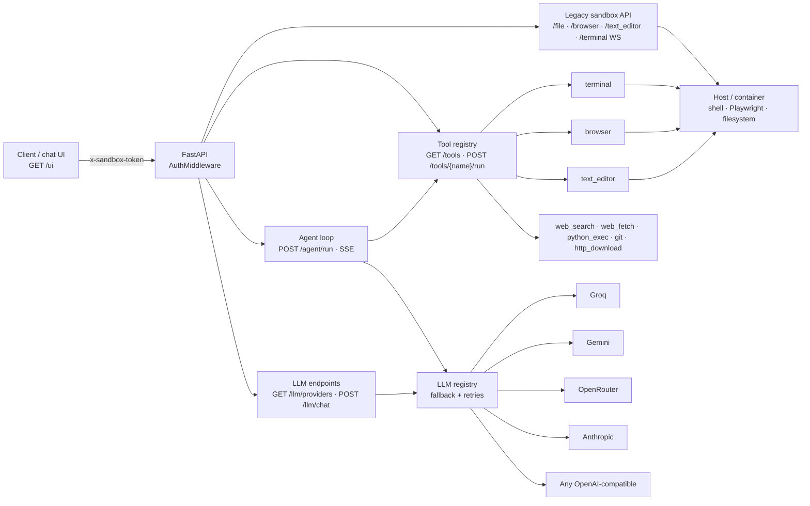

# Sandbar

**A self-hosted agent sandbox: terminal, browser and file APIs over HTTP/WS, a tool registry, a multi-provider LLM layer, and a streaming agent loop with a built-in chat UI.**

[](https://github.com/kasdo-iq/sandbar/actions/workflows/ci.yml)
[-blue.svg)](LICENSE)


---

## What it is

Sandbar runs a small FastAPI service that gives an LLM agent controlled access to
a real machine: a persistent shell, a Playwright browser, a file/text editor, and
a set of network and process tools. Every route is token-authenticated, and the
same process hosts the agent loop and the chat UI — point a browser at
`http://127.0.0.1:8330/ui` and you are working, with no separate frontend to
build or deploy.

It is a modernization of [whit3rabbit/manus-open](https://github.com/whit3rabbit/manus-open),
a reconstruction of the Manus sandbox container. The legacy Manus-compatible
surface is preserved at the API level; the auth layer, LLM layer, tool registry,
agent loop, UI, tests and CI were added here.

### How it differs from the original

| | Upstream `whit3rabbit/manus-open` | Sandbar |
|---|---|---|
| Authentication | none | token on every HTTP route and the WS handshake, fail-closed startup, per-IP 429 |
| LLM | Claude only, through the vendored agent | provider registry: Groq, Gemini, OpenRouter, Anthropic, any OpenAI-compatible endpoint, with fallback |
| Tools | fixed endpoints | registry with JSON Schemas, `GET /tools`, `POST /tools/{name}/run`, drop-in `custom_tools/` |
| Agent | — | `POST /agent/run`, SSE tool-calling loop with step/time limits |
| UI | — | `GET /ui`, single static page |
| Hardening | CORS `*`, no path checks | CORS allowlist, allowed-roots path safety, SSRF guards, shlex-quoted editor commands |
| Quality | no tests | 57 offline tests, ruff, GitHub Actions CI |

## Features

**Sandbox APIs (Manus-compatible)**

- Persistent terminals over WebSocket with the `[CMD_BEGIN]…[CMD_END]` protocol,
  plus per-session `reset / reset-all / view / write / kill` endpoints.
- Playwright browser control: bundled Chromium (headless by default) or attach
  your own Brave/Chrome over CDP.
- File upload/download including S3 multipart, text-editor actions, sandbox
  init, and zip-and-upload.

**Security**

- Token auth on every HTTP route and the WebSocket handshake (close code
  `1008` before accept).
- Fail-closed startup, constant-time comparison, failed-auth rate limiting
  (`429` + `Retry-After`).
- CORS allowlist, allowed-roots path checks (traversal and symlink escapes
  rejected), SSRF-guarded outbound fetches, `shlex`-quoted editor commands.

**LLM layer**

- `providers.yaml` plus env overrides: Groq, Gemini, OpenRouter, Anthropic and
  any OpenAI-compatible service.
- Fallback chain with retries and exponential backoff, per-request
  provider/model override, `GET /llm/providers` that never returns keys.
- `POST /llm/chat` one-shot or SSE-streamed, and a LangChain adapter so the
  vendored browser agent can run on any configured provider.

**Tools and agent**

- Registry with JSON Schemas: `GET /tools`, `POST /tools/{name}/run`.
- Built-ins: `terminal`, `browser`, `text_editor`, `python_exec`, `web_fetch`,
  `web_search`, `file_search`, `git`, `http_download`, `process_manager`.
- `POST /agent/run`: SSE tool-calling loop with `max_steps`, a total timeout,
  and truncated tool output before it is fed back to the model.
- Drop a `.py` file into `custom_tools/` to add your own tool at startup.

**Chat UI**

- `/ui`: one static page, no build step, no CDN, works offline.
- Streams the agent over SSE, renders escaped markdown, shows every tool call as
  a collapsible block, provider picker, stop button, optional voice input, dark
  theme, `dir="auto"` bubbles for mixed Arabic/English.

## Architecture



A request either hits a legacy endpoint directly, or goes through the tool
registry. `POST /agent/run` alternates between the LLM registry and the tool
registry until the model answers or the step/time budget runs out, emitting SSE
events the whole way. The chat UI is just another client of that same API.

## Requirements

- **Python 3.11+** (the container targets 3.11; 3.12 also works).
- **Linux, WSL or Docker** for the terminal and text-editor tools: they need
  `pexpect` and a POSIX shell. The HTTP server does start on Windows and macOS,
  but those two tool families fail there. Everything else — auth, LLM layer,
  HTTP tools, chat UI — works cross-platform.
- **Playwright Chromium** if you use the bundled browser:
  `python -m playwright install chromium`. Skip it if you attach your own
  browser over CDP.
- At least one LLM key for agent/LLM features. Search keys are optional.

## Quick start

```bash
git clone https://github.com/kasdo-iq/sandbar.git
cd sandbar

python -m venv .venv
source .venv/bin/activate            # Windows: .\.venv\Scripts\Activate.ps1
pip install -r requirements.txt
pip install -r requirements-dev.txt  # tests + ruff

cp .env.example .env
cp providers.example.yaml providers.yaml

# generate a token and put it in SANDBOX_API_TOKEN in .env
python -c "import secrets; print(secrets.token_hex(32))"

python -m playwright install chromium
python start_server.py --port 8330
```

Verify:

```bash
curl http://127.0.0.1:8330/healthz
curl http://127.0.0.1:8330/llm/providers                       # 401 without a token
curl -H "x-sandbox-token: $SANDBOX_API_TOKEN" \
     http://127.0.0.1:8330/llm/providers                       # 200
```

Then open <http://127.0.0.1:8330/ui> and paste the token once.

`start_server.py` takes `--port` (default `8330`), `--host` (default `0.0.0.0`),
`--log-level` and `--chrome-path`. For local use, `--host 127.0.0.1` keeps it
off the network.

> **Windows:** run the server with the repo virtualenv
> (`.\.venv\Scripts\python start_server.py`). Terminals and `text_editor` will
> not work outside WSL/Docker — see Requirements.

## Configuration

All values can live in `.env` (loaded at import time) or in the environment.
Copy `.env.example`; never commit the result.

| Variable | Purpose | Default |
|---|---|---|
| `SANDBOX_API_TOKEN` | token for every endpoint | **required** (or `AUTH_DISABLED=true`) |
| `AUTH_DISABLED` | run without auth (loud warning, local dev only) | `false` |
| `CORS_ORIGINS` | comma-separated CORS allowlist | empty (no cross-origin access) |
| `MANUS_COMPAT` | enable the Manus proxy client in `data_api.py` | `true` |
| `RUNTIME_API_HOST` | Manus proxy host for `data_api.py` | `https://api.manus.im` |
| `PROVIDERS_CONFIG` | path to the provider config | `providers.yaml` |
| `LLM_DEFAULT_PROVIDER`, `LLM_FALLBACK` | routing overrides | from `providers.yaml` |
| `LLM_<NAME>_MODEL`, `_BASE_URL`, `_ENABLED`, `_API_KEY`, `_TEMPERATURE`, `_MAX_TOKENS`, `_SYSTEM_PROMPT` | per-provider overrides | from `providers.yaml` |
| `GROQ_API_KEY`, `GEMINI_API_KEY`, `OPENROUTER_API_KEY`, `ANTHROPIC_API_KEY` | provider keys, referenced by name from `providers.yaml` | — |
| `TAVILY_API_KEY`, `SERPER_API_KEY`, `SEARXNG_URL` | `web_search` backends, in that priority order | — |
| `SANDBOX_ALLOWED_ROOTS` | comma-separated roots for every file-touching endpoint | working directory (`/home/ubuntu` in the container) |
| `SANDBOX_ALLOW_SUDO` | set by the Dockerfile from the `ALLOW_SUDO` build arg | `true` |
| `CUSTOM_TOOLS_DIR` | folder scanned for drop-in tools | `custom_tools` |
| `AGENT_MAX_STEPS` | max LLM steps per run | `15` |
| `AGENT_TOTAL_TIMEOUT` | wall-clock budget per run, seconds | `300` |
| `AGENT_SYSTEM_PROMPT` | overrides the built-in system prompt | built-in |
| `AGENT_OUTPUT_MAX_CHARS` | tool output truncation before it goes back to the model | `16000` |
| `PYTHON_EXEC_TIMEOUT`, `PYTHON_EXEC_MAX_MEMORY_MB` | `python_exec` limits | `60`, `1024` |
| `WEB_FETCH_MAX_BYTES`, `WEB_FETCH_TIMEOUT`, `HTTP_DOWNLOAD_TIMEOUT` | outbound fetch limits | `5 MiB`, `30`, `60` |
| `CHROME_INSTANCE_PATH` | Chrome binary path hint for browser_use | unset (bundled Chromium) |
| `BROWSER_HEADLESS` | `false` opens a visible browser window | `true` |
| `BROWSER_CDP_URL` | attach to an existing browser, e.g. `http://localhost:9222` | unset |
| `BROWSER_USE_LOGGING_LEVEL` | log level of the vendored agent | `info` |
| `ANONYMIZED_TELEMETRY` | PostHog telemetry from the vendored agent | `false` in `.env.example` |
| `LAMINAR_API_KEY` | enables Laminar tracing only if set | unset |

Provider credentials are **never** stored in `providers.yaml`; that file only
names the environment variable (`api_key_env`) that holds each key.

## Authentication

- Send `x-sandbox-token: <token>` (Manus-compatible) **or**
  `Authorization: Bearer <token>`.
- The token comes from `SANDBOX_API_TOKEN`. Comparison is constant-time
  (`hmac.compare_digest`) and tokens are never logged.
- Applied to every HTTP route **except** `GET /healthz` and `GET /ui` (the
  static page; every API call it makes still needs the token).
- **Fail closed:** without a token the server refuses to start unless
  `AUTH_DISABLED=true` is set explicitly.
- WebSocket `/terminal`: token from the handshake headers or `?token=`; an
  invalid token closes the socket with code `1008` before accept.
- More than 10 failed attempts per IP per minute → `429` with `Retry-After`.

## API overview

| Group | Endpoints |
|---|---|
| Health / UI | `GET /healthz`, `GET /ui` |
| Files | `GET /file`, `POST /file/upload_to_s3`, `POST /file/multipart_upload_to_s3`, `POST /request-download-attachments` |
| Browser | `GET /browser/status`, `POST /browser/action` |
| Editor | `POST /text_editor` |
| Terminals | `WS /terminal`, `POST /terminal/{id}/reset`, `POST /terminal/reset-all`, `GET /terminal/{id}/view`, `POST /terminal/{id}/kill`, `POST /terminal/{id}/write` |
| Sandbox | `POST /init-sandbox`, `POST /zip-and-upload` |
| Tools | `GET /tools`, `POST /tools/{name}/run` |
| Agent | `POST /agent/run` (SSE) |
| LLM | `GET /llm/providers`, `POST /llm/chat` (SSE when `stream=true`) |

[`openapi.yaml`](openapi.yaml) is the hand-maintained reference. Note that
`/terminal` is a WebSocket route, so it never shows up in FastAPI's generated
schema — it is documented in the YAML by hand. `app/README.md` also documents
the original endpoint family.

## Web search

`web_search` picks the first configured backend:

1. **Tavily** — `TAVILY_API_KEY`
2. **Serper** — `SERPER_API_KEY` (Google results via `google.serper.dev`)
3. **SearXNG** — `SEARXNG_URL`

With none configured the tool returns `{"status": "disabled"}` rather than an
error, so an agent can keep working without search. Every backend returns the
same `{title, url, snippet}` shape.

## Chat UI

Open <http://127.0.0.1:8330/ui>. It is a single file
(`app/static/ui/index.html`) with inline CSS/JS — no build step, no CDN, no
external requests.

- The token is asked for once and kept in `sessionStorage` for that tab only;
  it is sent as `x-sandbox-token` and never put in the URL or `localStorage`.
  A `401` clears it and asks again.
- `POST /agent/run` is consumed with `fetch` + `ReadableStream`, so the page
  renders each SSE event as it arrives. The API emits one `assistant_text`
  block per step (the loop calls the non-streaming chat API), not one token at
  a time.
- Assistant text is escaped before any markdown formatting is applied; links are
  restricted to `http(s)`.
- Tool calls appear as collapsible blocks with arguments and a truncated result.
- `POST /agent/run` is stateless — one `goal` per request — so the page keeps the
  conversation history client-side and sends only the new message.
- Voice input uses the Web Speech API (`ar-IQ` / `en-US`) and the button is
  hidden when the browser does not expose it.

## Using your own browser (Brave / Chrome)

By default the sandbox launches Playwright's bundled Chromium. To drive your
own browser instead, start it with a debugging port and point `BROWSER_CDP_URL`
at it:

```bash
# Linux
brave-browser --remote-debugging-port=9222
# Windows (PowerShell)
& "C:\Program Files\BraveSoftware\Brave-Browser\Application\brave.exe" --remote-debugging-port=9222

export BROWSER_CDP_URL=http://localhost:9222
python start_server.py --port 8330
```

`CHROME_INSTANCE_PATH` alone does **not** launch the binary — the vendored
agent attaches over CDP on port 9222. Use `BROWSER_CDP_URL` to opt in
explicitly.

## Docker

```bash
docker build -t sandbar .
docker run --rm -p 8330:8330 -e SANDBOX_API_TOKEN=<token> sandbar

# hardened: no passwordless sudo in the image
docker build --build-arg ALLOW_SUDO=false -t sandbar-hardened .
docker run --rm -p 8330:8330 -e SANDBOX_API_TOKEN=<token> sandbar-hardened
```

The base image tag must stay in lockstep with the `playwright` pin in
`requirements.txt` (`mcr.microsoft.com/playwright/python:v1.64.0-noble`).

> **Status: unverified.** The Dockerfile has not been built or run in the
> environment this repository was prepared in (no Docker daemon available).
> Treat the commands above as documented intent and smoke-test them on your
> own host before relying on the image.

## Testing

```bash
pytest tests/            # offline: no keys, no network
pytest tests/ -m smoke   # fast subset
ruff check .             # lint
```

57 tests cover auth, path safety, the SSRF guards, the LLM registry, the tool
registry, the agent loop, the chat UI contract and `data_api.py`. Markers are
declared in `pytest.ini`. **Do not run `ruff format`** — it rewrites the
reconstructed legacy sources.

CI (`.github/workflows/ci.yml`) runs `ruff check .` and `pytest tests/` on
Python 3.11 with no secrets.

## Security

Short version: the token is full control of the machine, so treat it like an
SSH key; bind to loopback or put a TLS proxy in front; never commit `.env` or
`providers.yaml`.

The longer version, including how to report a vulnerability, is in
[`SECURITY.md`](SECURITY.md). Known limitations: the terminal WebSocket trusts
an authenticated client for the whole session, `python_exec` memory limits are
POSIX-only, and the sandbox is a trusted-operator tool rather than a
multi-tenant jail.

## Roadmap

- True token-level streaming in the agent loop (today: one text block per step).
- Verify and publish the Docker image; add a Compose example with a CDP browser
  sidecar.
- Optional per-tool allowlists and an audit log per run.
- Session persistence for the chat UI, once `/agent/run` accepts history.

## License and credits

- Original code added in this repository: **MIT** — see [`LICENSE`](LICENSE).
  The license is scoped; read it.
- The reconstructed Manus sandbox layer has **no license** upstream. Publishing
  or redistributing this repository requires clarifying those rights first —
  see [`THIRD_PARTY_NOTICES.md`](THIRD_PARTY_NOTICES.md).
- `browser_use/` is a fork of [browser-use](https://github.com/browser-use/browser-use),
  MIT, © 2024 Gregor Zunic.
- Upstream reconstruction: [whit3rabbit/manus-open](https://github.com/whit3rabbit/manus-open)
  and the [bytecode-reconstruction gist](https://gist.github.com/jlia0/db0a9695b3ca7609c9b1a08dcbf872c9).
- Not affiliated with, endorsed by, or sponsored by Manus. The name "Manus" is
  used only to describe API compatibility and provenance.

## Project layout

```text
app/
  server.py            legacy HTTP/WS endpoints (Manus-compatible surface)
  auth.py              token middleware, CORS, rate limiting
  pathsafety.py        allowed-roots checks
  agent/               tool-calling loop + POST /agent/run
  llm/                 provider registry, clients, SSE, browser adapter
  tools/               registry, adapters, built-in tools
  static/ui/           single-page chat UI (GET /ui)
  types/, models.py    Manus-compatible request/response models
browser_use/           vendored fork of browser-use (MIT)
app_data/js/           injection JS required by the vendored agent
custom_tools/          drop-in tools, discovered at startup
tests/                 offline pytest suite
openapi.yaml           hand-maintained API reference
AGENTS.md              internals, invariants and gotchas for contributors/agents
AUDIT.md               phase-0 code audit of the reconstructed sources
```
